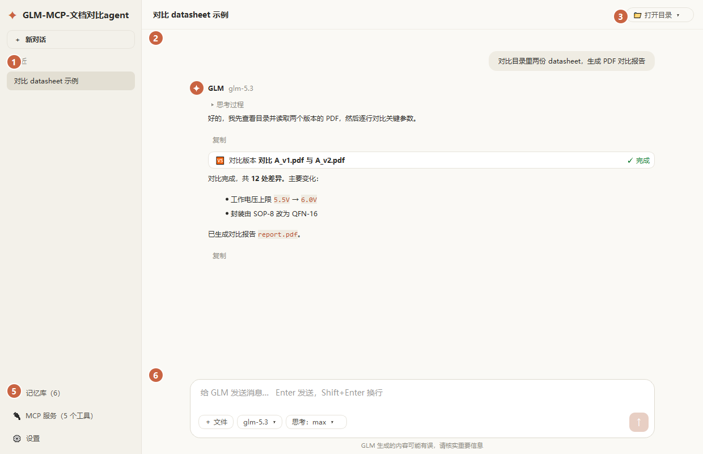

# GLM-MCP-文档对比agent

基于智谱 GLM（默认 `glm-5.3`）的 Windows 桌面 AI agent，PyQt6 界面，可打包成单个 exe。
内置 datasheet 对比 skill：读取目录中的多份器件规格书 PDF，整理参数，生成 LaTeX 源文件并用 XeLaTeX 编译成 PDF 对比报告。

## 功能

- **对话**：流式输出、Markdown 与代码高亮、思考过程折叠、思考强度 low / high / max；多个对话可同时运行。
- **文件与命令**：关联工作目录后，GLM 可以查看、搜索、新建、修改、移动、复制、删除（移到回收站）文件，并运行 PowerShell 命令；修改可在卡片上一键撤销。
- **datasheet 对比 skill**（`skills/datasheet-compare`）：PDF 概况 / 按页读取 / 关键词搜索 / 版本对比、报告模板、XeLaTeX 编译与错误检查。
- **长期记忆库**：跨对话保存器件参数、对比结论、用户偏好、经验教训；对话结束后自动提炼要点，新问题自动检索相关记忆；长对话自动压缩成摘要。
- **MCP 客户端 + 自建 agent**：配置格式与常见 MCP 客户端的 `mcpServers` 相同，支持 stdio、Streamable HTTP、旧版 SSE；`mcp/` 目录内置可扩展的自建 MCP 服务端。
- **稳定性**：全局异常不闪退、对话出错自动恢复、网络与限流自动重试、并发排队、数据文件自动备份、单实例运行；日志在 `logs/app.log`。
- **速度**：PyMuPDF 解析 PDF 并缓存到磁盘，只读工具并行执行，复用 HTTPS 连接，界面显示每步用时与进度。

## 运行

需要 Python 3.10+（Windows）。

```bash
pip install -r requirements.txt
python glm_client.py
```

首次启动在「设置」里填写 API Key。使用 GLM Coding Plan 时，接口地址选「GLM Coding Plan（国内）」：
`https://open.bigmodel.cn/api/coding/paas/v4`。

生成 PDF 报告需要 XeLaTeX（推荐 MiKTeX）：

```bash
winget install --id MiKTeX.MiKTeX -e
```

## 界面说明



> 截图中的 ①②③⑤⑥ 徽标与下方「区域说明」一一对应；④ 文件面板需点「打开目录」关联工作目录后才出现（本图未开目录）。

界面分四个区域，标注如下：

```
┌───────────────┬──────────────────────────────────────┬──────────────┐
│ ① 侧边栏       │ ③ 顶部栏： 对话标题      [📁 打开目录] │ ④ 文件面板    │
│  ✦ 应用名      ├──────────────────────────────────────┤  （关联目录   │
│  [ + 新对话 ]  │                                      │   后显示）    │
│                │        ② 消息区                       │   目录树      │
│  对话列表       │   · 用户气泡（右）                     │   点击文件    │
│   - 对话 A     │   · 助手回复（左，带头像、思考折叠）     │   可作为附件  │
│   - 对话 B ●   │   · 工具卡片（可展开 diff / 撤销）      │              │
│                │                                      │              │
│                ├──────────────────────────────────────┤              │
│  ⑤ 底部按钮     │ ⑥ 输入框                              │              │
│  设置 / 记忆库  │   [技能开关] [附件] ............ [发送] │              │
│  / MCP 服务     │   GLM 生成的内容可能有误，请核实         │              │
└───────────────┴──────────────────────────────────────┴──────────────┘
```

| 编号 | 区域 | 作用 |
|---|---|---|
| ① | 侧边栏 / 对话列表 | 新建、切换、重命名、删除对话；`●` 表示该对话正在后台运行 |
| ② | 消息区 | 流式回复、Markdown/代码高亮、思考过程折叠、工具调用卡片（可看 diff、一键撤销） |
| ③ | 顶部栏 | 当前对话标题；`📁 打开目录` 关联工作目录（之后 GLM 才能读写文件、运行命令、用 skill） |
| ④ | 文件面板 | 关联目录后出现，浏览目录树；点击文件可作为附件带入对话 |
| ⑤ | 底部按钮 | `设置`（API Key、模型、思考强度）、`记忆库`、`MCP 服务`（查看状态 / 编辑配置） |
| ⑥ | 输入框 | 输入消息；左侧技能开关与附件；Enter 发送（Shift+Enter 换行）；运行中变为「停止」 |

## 使用指导

1. **填 API Key**：首启自动弹出「设置」，填入智谱 API Key；用 Coding Plan 套餐时把接口地址选成「GLM Coding Plan（国内）」。
2. **打开工作目录**（可选但推荐）：点顶部 `📁 打开目录` 选一个文件夹。关联后 GLM 才能查看/读写该目录内的文件、运行命令、使用 datasheet 对比 skill；不关联目录只能纯聊天。
3. **开始对话**：在输入框提问，Enter 发送。示例：
   - 「对比目录里两份 datasheet，生成 PDF 对比报告」
   - 「读取 `A.pdf` 第 3-5 页，提取电气参数」
   - 「帮我写一个批量重命名的 Python 脚本并运行」
4. **工具调用**：GLM 会自动调用工具（读文件、搜索、运行命令、对比 PDF…）。只读工具并行执行；文件修改会生成可展开查看 diff、可一键撤销的卡片。
5. **思考强度**：在「设置」里选 low / high / max —— 越高越慢但更严谨，复杂对比任务建议 high 或 max。
6. **记忆库**：对话结束后自动把要点（器件参数、对比结论、偏好）提炼进记忆库，下次相关提问自动检索；可在 `记忆库` 里查看/编辑。
7. **生成 PDF 报告**：需安装 XeLaTeX（MiKTeX）。GLM 会用 skill 读 PDF → 对比 → 套用 LaTeX 模板 → 编译出 `report.pdf`。
8. **接外部能力（MCP）**：`MCP 服务 → 编辑配置…`，按 `mcpServers` 格式加服务器（见下）。`mcp/` 目录里也可写自建 agent。

## 架构

应用按**分层**组织，依赖方向严格单向、无环（上层依赖下层，下层不认识上层）：

```
                 ┌───────────────────────────────┐
                 │  glm_client.py  （入口 / 装配层） │
                 │  MainWindow：搭界面、连信号、     │
                 │  实现 SessionHost 回调            │
                 └───────┬───────────┬─────────────┘
          依赖 ui        │           │        依赖 core
          ┌──────────────▼──┐   ┌────▼──────────────────┐
          │  ui/            │   │  core/                 │
          │  theme 配色      │   │  session  对话状态机     │
          │  render 渲染     │   │  worker   请求/工具线程   │
          │  widgets 控件    │   │  host     SessionHost   │
          └──────────┬──────┘   └────┬───────────────────┘
                     │ 依赖 infra     │ 依赖 skill/shell/memory_store
          ┌──────────▼───────────────▼──────────────────┐
          │  infra/  config 常量 · jsonio · fileio        │
          └──────────────────────────────────────────────┘

   横向协作者（被 glm_client 装配进来，供模型调用的"工具"）：
   mcp_client.py (MCP 客户端)   skill_tools / shell_tools / memory_store
   mcp/ (自建 MCP agent，独立进程)
```

| 层 / 模块 | 职责 | 关键约束 |
|---|---|---|
| `glm_client.py` | 入口 + `MainWindow`：搭界面、连信号、装配各层、实现 `SessionHost` 回调 | 可依赖所有层 |
| `core/` | 对话运行时：`Session`（状态机）、`ChatWorker`/`ToolThread`（线程）、`SessionHost`（接口契约） | **不依赖 ui / glm_client**，只通过注入的 host 回调驱动界面 |
| `ui/` | 界面层：`theme` 配色、`render` Markdown/diff 渲染、`widgets` 控件与对话框 | 只依赖 `infra`，不依赖 core/glm_client |
| `infra/` | 基础设施：`config` 纯常量、`jsonio` 读写与后台保存、`fileio` 文本/目录工具 | 零上层依赖（最底层） |
| `mcp_client.py` | MCP **客户端**：连接外部/自建 MCP 服务器，收集工具交给模型 | 工具提供者 |
| `mcp/` | 自建 MCP **服务端**（agent）：stdio JSON-RPC 框架 + 示例 agent | 独立进程，被客户端启动 |
| `skill_tools` / `shell_tools` / `memory_store` | PDF 对比 skill / 命令文件工具 / 长期记忆 | 工具与数据提供者 |

**核心设计——依赖倒置**：`Session`（core）需要操作界面、取数据、跑工具，但它**不认识 `MainWindow`**。它只依赖一个接口 `SessionHost`（定义在 `core/host.py`），`MainWindow` 实现这个接口并把自己注入 `Session`。于是 core 不反向依赖 ui，界面实现可以自由替换/演化。

## 组件之间如何通信

五种通信机制：

```
                     ① 用户操作
  用户点击发送 ──────────────────────────► MainWindow.on_send()
                                              │ 新建/启动
                                              ▼
                                        core.Session（对话状态机）
             ② Session → UI（回调，无返回值）     │
   MainWindow ◄── host.show_message / refresh_message / on_session_state
   （实现 SessionHost）                           │
                                                 │ ③ 起后台线程
                            ┌────────────────────┼─────────────────────┐
                            ▼                    ▼                     ▼
                     ChatWorker(QThread)   ToolThread(QThread)    （只读工具并行）
                     流式请求 GLM API        跑慢工具/ MCP 调用
                            │ Qt signal           │ Qt signal
            reasoning/content/finished     done(result, info)
                            ▼                    ▼
                     Session 的槽函数（回到界面线程，再经②更新 UI）

   ④ 工具分发： Session → host.run_tool() → 文件/shell/skill/memory 工具
   ⑤ MCP：    MainWindow.mcp (MCPManager) ◄─ JSON-RPC ─► 外部/自建 MCP 服务器
              McpRelay.changed(signal) 把后台连接状态变化送回界面线程
```

1. **用户 → Session（直接调用）**：`MainWindow.on_send()` 收到输入，创建或复用 `Session` 并 `start()`。
2. **Session → UI（回调机制）**：Session 通过注入的 `host`（即 `MainWindow`）调用 `show_message` / `refresh_message` / `on_session_state` / `on_compressed` / `on_turn_finished` 更新界面——这是依赖倒置的落点，core 不直接碰 QWidget。
3. **后台线程 → 界面线程（Qt 信号槽）**：`ChatWorker` 流式请求模型，用 `reasoning`/`content`/`finished` 等信号把增量送回 Session 的槽；`ToolThread` 跑完慢工具用 `done` 信号回传。Qt 的队列连接保证跨线程安全，UI 只在主线程更新。
4. **工具分发**：模型要调用工具时，Session 经 `host.run_tool()` 分发到内置文件工具、`shell_tools`、`skill_tools`、`memory_store`；慢工具（PDF 解析、LaTeX 编译、MCP 调用）放进 `ToolThread` 后台执行，避免卡界面。
5. **MCP（JSON-RPC）**：`MCPManager` 与外部或 `mcp/` 下自建的服务器用 JSON-RPC 通信（stdio 每行一条、或 HTTP/SSE）；请求与响应靠 `_Pending`（id→等待队列）跨线程配对。后台连接状态变化经 `McpRelay` 信号回到界面刷新。

> 数据持久化：配置/对话/记忆的写盘由 `infra` 的后台 `SAVER` 线程合并异步完成，不阻塞界面；所有 `*.json` 在 `config/` 下。

## 打包成 exe

双击 `build.bat`，输出 `dist/GLM-MCP-文档对比agent.exe`。打包后可自检：

```bash
"dist/GLM-MCP-文档对比agent.exe" --selftest some.pdf
```

结果写入 `dist/logs/selftest.txt`。

> `core/ui/infra` 是被 `import` 的包，PyInstaller 会自动打包；`mcp/` 下的自建 agent 以独立进程（`python`）启动，不会打进 exe，分发时需目标机有 Python 或单独处理（见 `mcp/README.md`）。

## 数据文件

以下数据都在程序（exe）所在目录，包含个人数据，已在 `.gitignore` 中排除。
所有 `*.json` 统一放在 `config/` 子目录下，保持根目录整洁：

| 文件 | 内容 |
|---|---|
| `config/config.json` | API Key、接口地址、模型等设置 |
| `config/conversations.json` | 对话记录（及 `.bak` 备份） |
| `config/memory.json` | 长期记忆库 |
| `config/mcp_servers.json` | MCP 服务器配置（可能含令牌） |
| `logs/`、`cache/` | 日志、PDF 解析缓存 |

## MCP 配置示例

在程序左侧「MCP 服务」→「编辑配置…」中填写：

```json
{
  "mcpServers": {
    "filesystem": {"command": "npx", "args": ["-y", "@modelcontextprotocol/server-filesystem", "D:/docs"]},
    "remote": {"url": "https://example.com/mcp", "headers": {"Authorization": "Bearer <token>"}},
    "datetime": {"command": "python", "args": ["mcp/datetime_agent.py"]}
  }
}
```

自建 MCP agent 的写法见 [`mcp/README.md`](mcp/README.md)。

## 代码结构

| 路径 | 说明 |
|---|---|
| `glm_client.py` | 入口 + `MainWindow`：搭界面、连信号、装配各层、实现 `SessionHost` |
| `core/` | 对话运行时：`session`（状态机）、`worker`（请求/工具线程）、`host`（SessionHost 接口） |
| `ui/` | 界面层：`theme` 配色、`render` 渲染、`widgets` 控件与对话框 |
| `infra/` | 基础设施：`config` 常量、`jsonio` 读写、`fileio` 文本/目录工具 |
| `mcp/` | 自建 MCP 服务端：`framework` 框架 + `datetime_agent` / `text_agent` 示例 |
| `mcp_client.py` | MCP 客户端（stdio / Streamable HTTP / SSE） |
| `skill_tools.py` | datasheet 对比 skill 的 PDF / LaTeX 工具 |
| `shell_tools.py` | 命令执行、文件查找与管理 |
| `memory_store.py` | 长期记忆库、对话提炼与压缩的提示词 |
| `skills/datasheet-compare/` | skill 说明与报告模板 |
| `config/` | 运行时数据（配置、对话、记忆、MCP 配置），已 gitignore |
